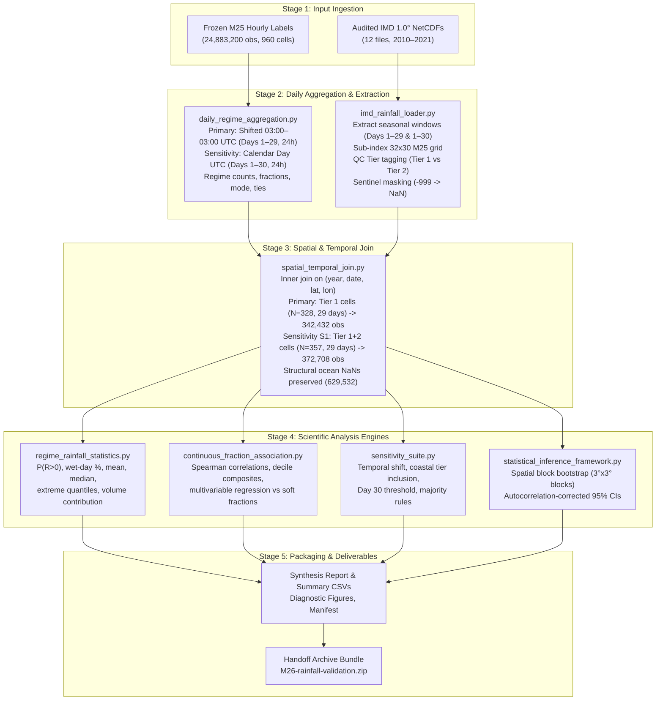

# M26 — Rainfall Validation: Comprehensive Implementation Plan (Revised Baseline)

**Milestone:** M26 — Rainfall Validation: Repository Inspection and Implementation Planning  
**Document Version:** 2.0 (Post-Review Revision — Reassessed D01 & D02)  
**Date:** 2026-11-17  
**Author:** Antigravity Integration & Scientific Audit Agent  
**Repository (Canonical):** `D:\Project Simulator\monsoon_cloud_research`  
**Worktree (Secondary):** `D:\Project Simulator\post_monsoon_research`  
**Status:** REVISED FORMAL PLANNING BASELINE — READY FOR IMPLEMENTATION  

---

## 1. Executive Summary & Research Mandate

The primary scientific objective of Milestone M26 is to evaluate the physical validity of the four satellite-discovered cloud regimes (R0, R1, R2, R3) from the frozen M25 model by evaluating their daily rainfall associations using the 12-year (2010–2021) India Meteorological Department (IMD) $1.0^\circ$ daily gridded rainfall dataset (`RFone`).

### Core Scientific Questions:
1. **Regime Distinctiveness:** Do the four M25 cloud regimes produce statistically distinguishable surface rainfall depth distributions, dry-day frequencies ($P(R = 0)$), wet-day frequencies ($P(R \ge 2.5\text{ mm})$), and extreme precipitation intensities ($P(R \ge Q_{95})$)?
2. **Seasonal Variability:** How do regime–rainfall relationships vary across the three distinct meteorological seasons (Pre-Monsoon, Established Monsoon, Post-Monsoon)?
3. **Physical Alignment:** Does Regime 2 (deep convective storm cores) consistently generate the heaviest precipitation intensities and highest wet-day probabilities, and does Regime 1 (boundary-layer shallow cumulus) consistently associate with suppressed rainfall?
4. **Methodological Robustness:** Are discovered regime–rainfall contrasts robust across analytical choices, including daily temporal aggregation conventions, spatial land-sea masking tiers, minimum cloud observation hour thresholds, and hard dominant vs. continuous soft regime representations?

### Absolute Scope Boundaries:
- **No Retraining or Modifying M25:** The M25 model artifacts ($24,883,200$ hourly labels across 960 grid cells) are **frozen**. No labels, feature scalings, or PCA representations shall be altered.
- **No Data Fabrication or External Substitution:** The local IMD 1.0° dataset (`RFone`, 12 annual NetCDFs) is the sole audited rainfall ground truth. The 0.25° `RF25` product is not present and shall not be substituted or fabricated.
- **No ENSO/IOD Modulation:** Climate index teleconnections (NOAA DMI, NOAA RONI) belong strictly to Milestone M27 and are excluded from M26.
- **No Spatial Sub-Clustering:** Geographical sub-regional partitioning belongs to later extensions. M26 focuses on domain-wide seasonal validation across verified terrestrial grid cells.
- **Zero Git Mutations:** No git commits, pushes, merges, rebases, or branch checkouts.

---

## 2. Reassessed Foundational Scientific Decisions (D01 & D02)

Following detailed technical review, two primary methodological decisions have been formally revised to ensure rigorous physical alignment with source meteorological observations:

### Decision D01 (Temporal Alignment Revision):
- **Primary Convention:** **Exact IMD Shifted 24-Hour Accumulation Window ($03:00\text{ UTC } D \text{ to } 03:00\text{ UTC } D+1$) for Complete Days 1–29.**
- **Physical Interval:** Hourly CERES observations centered at half-hours $\{D\text{ 03:30 \dots 23:30}\} \cup \{(D+1)\text{ 00:30 \dots 02:30}\}$.
- **Hourly Completeness:** Exactly **24 valid hourly observations out of 24** ($100.0\%$) for every matched day. Zero missing hours; zero silent interpolation.
- **Physical Overlap:** **100.0% physical temporal overlap** with the IMD rain-gauge accumulation cycle ($08:30\text{ IST } D \text{ to } 08:30\text{ IST } D+1$).
- **Boundary Exclusions:**
  - Day 1 early morning (00:00–03:00 UTC, 3 hours): Belongs to Day 0 accumulation (outside the 30-day window); excluded from daily aggregation.
  - Day 30 final hours (August 13 03:00–24:00 UTC, 21 hours): Incomplete final day (missing 3 hours from August 14); cleanly excluded from primary 24-hour analysis to prevent incomplete-day distortion.
- **Temporal Retention:** Preserves **29 complete days per season** ($1,044$ seasonal days across 12 years and 3 seasons), retaining **96.67% of the total temporal window** with zero phase shift.
- **Sensitivity Suite Protocol:** Primary results are compared against:
  - *Sensitivity S2 (UTC Calendar Day):* 30 days, $00:00–24:00\text{ UTC}$, 24 h/day, 87.5% temporal overlap.
  - *Sensitivity S4 (Shifted Incomplete Day 30):* 30 days, including Day 30 under an $\ge 18$-hour or 21-hour threshold.

### Decision D02 (Spatial Population Revision):
- **Primary Population:** **Tier 1 Full Terrestrial Cells ($N=328\text{ cells}$, $F_{\text{cov}} \ge 75\%$, $N_{\text{valid}} \ge 12$).**
- **Primary Observation Count:** Exactly **342,432 matched grid-day observations** ($3\text{ seasons} \times 12\text{ years} \times 29\text{ days} \times 328\text{ cells}$).
- **Scientific Justification:** Strictly adheres to the audited M25.4 Data Quality Policy (`imd_data_quality_policy.md`). Tier 1 cells possess full interior gauge support, minimizing spatial interpolation variance and coastal boundary distortion.
- **Sensitivity Suite Protocol:**
  - *Sensitivity S1 (Coastal Ingestion):* Ingests the 29 Tier 2 Coastal Cells ($N=357\text{ cells}$, $372,708\text{ observations}$) with an explicit `quality_tier = 'TIER_2_COASTAL'` column. Evaluates whether coastal sea-breeze convergence and marine boundary exposure modify regime–rainfall contrasts.

---

## 3. Comprehensive Observation Count Geometry

| Dataset / Analysis Protocol | Grid Cells | Days / Season | Obs / Year-Season | Obs / Season (12 yr) | Total Observations (36 seasons) | Status / Role |
|:---|:---:|:---:|:---:|:---:|:---:|:---|
| **Primary Analysis (Exact Shifted, Tier 1)** | **328** | **29** | **9,512** | **114,144** | **342,432** | **PRIMARY BENCHMARK** |
| **Sensitivity S1 (Coastal Ingestion: Tier 1 + Tier 2)** | 357 | 29 | 10,353 | 124,236 | 372,708 | Sensitivity (Tier 2 flagged) |
| *— Tier 2 Coastal Cells Alone* | *29* | *29* | *841* | *10,092* | *30,276* | Diagnostic Coastal Subset |
| **Sensitivity S2 (Calendar Day UTC, Tier 1)** | 328 | 30 | 9,840 | 118,080 | 354,240 | Temporal Sensitivity (87.5% overlap) |
| **Sensitivity S3 (Calendar Day UTC, Tier 1 + Tier 2)** | 357 | 30 | 10,710 | 128,520 | 385,560 | Legacy Abhin Baseline |
| **Sensitivity S4 (Shifted Window with Day 30 at 21h)**| 328 | 30 | 9,840 | 118,080 | 354,240 | Incomplete Day Sensitivity |
| **Structural Ocean Absences (Tier 4, 29-day)** | 603 | 29 | 17,487 | 209,844 | 629,532 | Preserved `NaN` (Zero-filling banned)|
| **Full Domain Cloud Table (29-day grid)** | 960 | 29 | 27,840 | 334,080 | 1,002,240 | Intermediate Daily Cloud Array |
| **Full Domain Cloud Table (30-day grid)** | 960 | 30 | 28,800 | 345,600 | 1,036,800 | Intermediate Daily Cloud Array |

---

## 4. Existing Artifacts to Reuse

The implementation will directly ingest verified repository assets:

1. **Frozen M25 Outputs (`data/processed/combined_3season/`):**
   - `combined_3season_cluster_labels.npy`: $24,883,200$ hourly cluster assignments ($0, 1, 2, 3$).
   - `combined_3season_cell_indices.npy`: $24,883,200$ spatial cell identifiers ($0 \dots 959$).
   - `combined_3season_years.npy`: $24,883,200$ observation years ($2010 \dots 2021$).
   - `combined_3season_season_ids.npy`: $24,883,200$ season identifiers ($0$: Pre-Monsoon, $1$: Established Monsoon, $2$: Post-Monsoon).
2. **Raw Audited IMD Rainfall Archive (`raw_data/IMD_Rainfall/`):**
   - 12 CF-1.6 NetCDF files: `RFone_imd_rf_1x1_2010.nc` through `RFone_imd_rf_1x1_2021.nc`.
3. **M25.4 Policy & Architecture Specifications (`reports/integration/m25_4/imd_rainfall_readiness/`):**
   - `imd_data_quality_policy.md`: Land-sea masking tiers, genuine zero handling, zero-filling ban.
   - `imd_ceres_grid_mapping_design.md`: Native sub-indexing geometry ($32 \times 30$ domain).
   - `imd_rainfall_provenance_report.md`: Provenance, units ($\text{mm}$), and observation intervals.
4. **Algorithmic Templates:**
   - `src/seasons/established_monsoon/analysis/established_monsoon_rainfall_association.py` (precedent metrics: mean, median, quantiles, wet-day threshold $2.5\text{ mm}$).
   - `src/integration/run_m25_3_established_monsoon_correspondence.py` (Phase C vectorized daily aggregation, dominant regime, and tie tracking).

---

## 5. New Module Architecture & Responsibilities

All new source code will reside in `src/integration/rainfall_association/`:

```
src/integration/rainfall_association/
├── __init__.py
├── daily_regime_aggregation.py       # Aggregates hourly M25 labels to daily summaries (29-day shifted & 30-day calendar)
├── imd_rainfall_loader.py            # Ingests, subsets, and QC-tags IMD daily rainfall (Tier 1 vs Tier 2)
├── spatial_temporal_join.py          # Joins daily cloud summaries with rainfall on (year, date, lat, lon)
├── regime_rainfall_statistics.py     # Computes parametric & non-parametric rainfall statistics
├── continuous_fraction_association.py# Analyzes rainfall against continuous soft regime fractions
├── sensitivity_suite.py              # Evaluates 4-dimensional sensitivity matrix (S1, S2, S3, S4)
├── statistical_inference_framework.py# Spatial block bootstrap & spatial autocorrelation adjustments
└── m26_orchestrator.py               # Master execution pipeline
```

### Module Specifications:

### A. `daily_regime_aggregation.py`
- Ingests `combined_3season_cluster_labels.npy` ($24,883,200$ hourly labels).
- Reshapes labels into dimensional grid: $(\text{Seasons}=3, \text{Years}=12, \text{Hours}=720, \text{Cells}=960)$.
- **Primary Aggregation (Exact Shifted Window):**
  - For each day $d \in [0, 28]$ (29 complete days), extracts the 24 hours:
    $$\text{Hour indices } h \in [d \times 24 + 3, (d+1) \times 24 + 3)$$
  - Computes regime counts $C_k = \sum \mathbb{I}(R == k)$, soft fractions $f_k = C_k / 24.0$, dominant regime $R_{\text{dom}} = \operatorname{argmax}_k(C_k)$, and tie flags.
  - Confirms valid assigned hours = 24 ($100\%$ complete).
- **Secondary Aggregation (Calendar Day):**
  - Groups 24 hours by UTC calendar day ($h \in [d \times 24, (d+1) \times 24)$) for sensitivity comparisons.
- Output: Master daily regime dataset with alignment flags.

### B. `imd_rainfall_loader.py`
- Ingests 12 annual NetCDF files from `raw_data/IMD_Rainfall/`.
- Slices the approved seasonal days:
  - Primary Window: Days 1–29 for each year-season ($1,044$ days total).
  - Extended Window: All 30 days for sensitivity testing ($1,080$ days total).
- Extracts canonical M25 domain via native coordinate sub-indexing:
  - Latitudes: Indices $0 \dots 31$ ($6.5^\circ\text{N} \dots 37.5^\circ\text{N}$).
  - Longitudes: Indices $2 \dots 31$ ($68.5^\circ\text{E} \dots 97.5^\circ\text{E}$).
- Quality Control & Masking:
  - Replaces missing sentinel $-999.0$ with `NaN`.
  - Preserves genuine physical zeros ($0.0\text{ mm}$).
  - Tags each grid cell with M25.4 Quality Tiers:
    - Tier 1: Full land ($F_{\text{cov}} \ge 75\%$, 328 cells).
    - Tier 2: Partial coastal ($25\% \le F_{\text{cov}} < 75\%$, 29 cells).
    - Tier 4: Ocean structural absence (603 cells, preserved as `NaN`).

### C. `spatial_temporal_join.py`
- Joins the daily cloud regime table with the daily rainfall table on `(year, date, latitude, longitude)`.
- Verification Gates:
  - Primary Analysis Join: Exactly **342,432 rows** (Tier 1, 29 complete days).
  - Sensitivity S1 Join: Exactly **372,708 rows** (Tier 1 + Tier 2, 29 complete days).
  - Zero duplicate keys; zero coordinate drift ($\Delta = 0.000^\circ$).
  - Structural ocean absences ($629,532$ NaNs across 29 days) strictly preserved.

### D. `regime_rainfall_statistics.py`
- Computes comprehensive statistical characterizations conditioned on regime $k \in \{0, 1, 2, 3\}$, stratified by season, pooled record, and individual years:
  - Sample size $N_k$, prevalence $\%$.
  - Occurrence: $P(R = 0 \mid R_k)$, $P(R > 0 \mid R_k)$, $P(R \ge 2.5\text{ mm} \mid R_k)$ (wet days), $P(R \ge 35.5\text{ mm} \mid R_k)$ (heavy rain).
  - Central tendency & dispersion: Unconditional mean $\bar{R}_k$, wet-day conditional mean $\bar{R}_{k \mid R>0}$, median $\tilde{R}_k$, IQR, standard deviation.
  - Extremes: 75th, 90th, 95th, 99th percentiles ($Q_{75}, Q_{90}, Q_{95}, Q_{99}$), maximum observed depth.
  - Volumetric contribution share $C_k = \frac{\sum_{i \in R_k} R_i}{\sum R_{\text{total}}} \times 100\%$.
  - Extreme event attribution $A_k = P(R_k \mid R \ge Q_{95}) \times 100\%$.

### E. `continuous_fraction_association.py`
- Models daily rainfall $R_i$ as a continuous function of the soft regime fraction vector $\mathbf{f}_i = (f_{i,0}, f_{i,1}, f_{i,2}, f_{i,3})$.
- Computes:
  - Spearman rank correlation between daily rainfall depth and regime fractions $r_s(R, f_k)$.
  - Binned rainfall composites across deciles of convective fraction ($f_2$) and congestus fraction ($f_0$).
  - Multivariable linear/Tobit regression referencing R3 as baseline:
    $$R_i = \beta_0 + \beta_1 f_{i,0} + \beta_2 f_{i,1} + \beta_3 f_{i,2} + \epsilon_i$$

### F. `sensitivity_suite.py`
- Executes systematic perturbation experiments across the 4 primary dimensions:
  1. *Dimension 1 (Temporal Alignment):* Exact Shifted 29-Day (Primary) vs. UTC Calendar Day (Sensitivity S2).
  2. *Dimension 2 (Spatial Quality Tiers):* Tier 1 Full Land (Primary, 328 cells) vs. Tier 1 + Tier 2 Coastal (Sensitivity S1, 357 cells).
  3. *Dimension 3 (Boundary Day Treatment):* Day 30 Excluded (Primary) vs. Day 30 Included at 21h (Sensitivity S4).
  4. *Dimension 4 (Regime Dominance Threshold):* Simple Plurality ($\max$) vs. Strict Absolute Majority ($f_k > 0.50$).

### G. `statistical_inference_framework.py`
- Implements spatial block bootstrap and clustered standard errors:
  - Resamples contiguous spatial blocks of $3^\circ \times 3^\circ$ (9 grid cells) across moving temporal blocks of 5 consecutive days within the 29-day seasonal record.
  - 1,000 bootstrap iterations construct empirical 95% confidence intervals for all primary metrics.
  - Block-permutation hypothesis tests comparing regime distributions while preserving observed space-time covariance.

### H. `m26_orchestrator.py`
- Master script executing the end-to-end pipeline deterministically.
- Enforces data integrity checks, logs checksums, row counts, and verification gates.

---

## 6. Data-Flow Architecture



---

## 7. Automated Testing Strategy

The test module `tests/integration/test_m26_rainfall_validation.py` will assert:
- `test_daily_regime_aggregation_completeness`: Asserts 24/24 valid hours for all matched records in Days 1–29; asserts Day 30 is flagged incomplete (21h).
- `test_spatial_temporal_join_primary_counts`: Asserts exactly **342,432 matched records** for Tier 1 across 29 complete days ($3 \times 12 \times 29 \times 328$).
- `test_spatial_temporal_join_sensitivity_counts`: Asserts exactly **372,708 matched records** for Tier 1 + Tier 2 across 29 complete days ($3 \times 12 \times 29 \times 357$).
- `test_zero_and_ocean_nan_integrity`: Asserts dry days ($0.0\text{ mm}$) are present and ocean cells are strictly `NaN`. Zero-filling ban enforced.
- `test_regime_rainfall_ranking`: Asserts physical consistency: $\bar{R}_2 > \bar{R}_1$ and $P(R \ge 2.5 \mid R_2) > P(R \ge 2.5 \mid R_1)$.
- `test_temporal_sensitivity_stability`: Asserts regime rainfall ranking is invariant between Exact Shifted 29-day and Calendar Day 30-day analyses.
- `test_no_git_mutation`: Asserts repository working tree remains clean.

---

## 8. Computational & Memory Budget

- **Peak Memory Budget:** $< 1.5\text{ GB}$ RAM (vectorized NumPy and memory-mapped arrays).
- **Execution Time:** $< 45\text{ seconds}$ on standard multi-core CPU.
- **Disk Footprint:** Intermediate tables $< 50\text{ MB}$.
